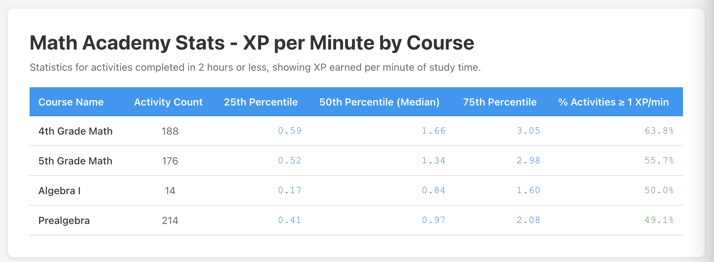

# Math Academy Stats

[](https://github.com/rahimnathwani/mathacademy-stats/actions/workflows/ci.yml)
[](https://chromewebstore.google.com/detail/math-academy-stats/fkjemgghojefccgmlimnanhnofndckin)
[](https://addons.mozilla.org/en-US/firefox/addon/math-academy-stats/)
[](LICENSE)

A browser extension for Chrome and Firefox that analyzes your [Math Academy](https://mathacademy.com) activity data: charts, statistics, and CSV/JSON export. All analysis happens locally in your browser.



## Features

- **Daily Overview**: total XP, activities, XP/day, and attainment rate with time-series charts and course-transition markers
- **XP/Minute Stats**: percentiles and threshold analysis by course and activity type
- **XP/min Trend**: daily and weekly XP-per-minute over time, with a 7-day rolling average and week-over-week change
- **Performance Histograms**: XP/min distributions for lessons and reviews, per course
- **Daily XP Distribution**: histogram of daily XP totals with mean and median
- **Activity Heatmap**: GitHub-style calendar of your last year of learning
- **Task Types Analysis**: lessons, reviews, quizzes, multisteps, diagnostics breakdown
- **Weekday Patterns**: average XP by day of week
- **Upcoming Topics**: frontier topics ranked by how solid their prerequisites are
- **Export**: full activity data as JSON, or CSV for spreadsheets

## Installation

### Browser web store (recommended)

- **Chrome**: [Chrome Web Store](https://chromewebstore.google.com/detail/math-academy-stats/fkjemgghojefccgmlimnanhnofndckin)
- **Firefox**: [Firefox Add-ons](https://addons.mozilla.org/en-US/firefox/addon/math-academy-stats/)

### From a GitHub release

1. Download `chrome-mv3.zip` or `firefox-mv2.zip` from the [Releases page](https://github.com/rahimnathwani/mathacademy-stats/releases) and extract it
2. **Chrome**: open `chrome://extensions/`, enable "Developer mode", click "Load unpacked", select the extracted folder
3. **Firefox**: open `about:debugging#/runtime/this-firefox`, click "Load Temporary Add-on", select the extracted `manifest.json`

### From source

```bash
git clone https://github.com/rahimnathwani/mathacademy-stats.git
cd mathacademy-stats
pnpm install
pnpm run build          # Chrome  -> .output/chrome-mv3/
pnpm run build:firefox  # Firefox -> .output/firefox-mv2/
```

Then load the output directory as an unpacked extension (steps above).

## Usage

1. Log in to Math Academy (mathacademy.com or www.mathacademy.com)
2. Click the extension icon and press **Fetch Activity Data** — fetching is incremental, so refreshes only pull new activities
3. Open any report from the popup, or export your data as JSON/CSV

## How statistics are computed

- **XP per minute**: `pointsAwarded / durationMinutes`, grouped by the course you were in when you completed the activity
- **Outlier filtering**: activities taking longer than 2 hours are excluded — a long gap usually means the tab was left open, not 2+ hours of continuous work
- **Diagnostics**: counted as 100% attainment, since diagnostics have no fixed base point value
- **Daily grouping**: uses your local timezone, so late-evening sessions count toward the right day

## Privacy

- Your activity data is fetched directly from Math Academy's API using your existing login session
- Everything is stored and processed locally in your browser; nothing is sent to any third-party server
- Permissions: `storage` (pass data between popup and report pages), `tabs` (open report tabs, detect which Math Academy hostname you use), and host access to `mathacademy.com` (call the API)

## Development

```bash
pnpm install            # install dependencies
pnpm run dev            # Chrome dev server with hot reload
pnpm run dev:firefox    # Firefox dev server with hot reload
pnpm run check          # typecheck + lint + format check
pnpm run zip            # package Chrome extension
pnpm run zip:firefox    # package Firefox extension
```

Built with [WXT](https://wxt.dev), React, TypeScript, and [uPlot](https://github.com/leeoniya/uPlot). Manifest V3 for Chrome, V2 for Firefox, from a single codebase.

- `entrypoints/` — popup and one directory per report page (WXT file-based entrypoints)
- `components/`, `hooks/`, `utils/` — shared UI and logic
- `docs/api-samples/` — example Math Academy API responses
- `CLAUDE.md` — architecture notes

Releases are cut by pushing a `v*.*.*` tag; CI builds and attaches both zips. See [docs/firefox-release.md](docs/firefox-release.md) for the AMO submission guide.

## License

[MIT](LICENSE)
